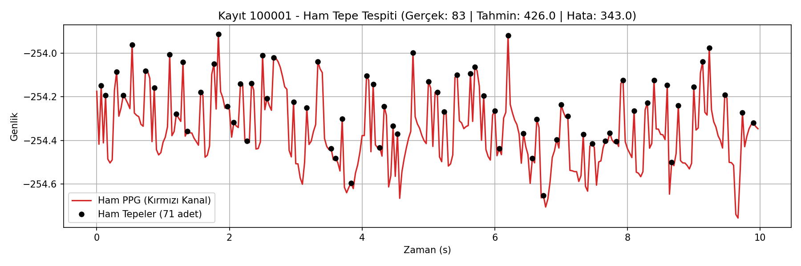

# Akıllı Telefon PPG Sinyalinden Nabız Kestirimi (Heart Rate Estimation)

Bu proje, akıllı telefon kameralarından parmak ucu temasıyla kaydedilen optik fotopletismografi (PPG) sinyallerini klasik sayısal sinyal işleme metotları kullanarak işlemeyi ve klinik EKG referansına göre kalp atım hızını (HR - atım/dk) tahmin etmeyi amaçlar.

> **Not:** Çalışmada makine öğrenmesi veya yapay zekâ modeli kullanılmamış; tamamen klasik frekans analizi ve filtreleme teknikleri uygulanmıştır.

---

## 📊 Proje Özeti ve Başarı Metrikleri

Filtresiz ham sinyalde yapılan yerel tepe sayımı (Baseline), kamera sensör gürültüsü ve el titremeleri sebebiyle gerçekçi olmayan sonuçlar üretmektedir. Butterworth bant geçiren filtre ve sıfır dolgulu (zero-padding) Fourier spektrum analizi ile gürültü bastırılmış ve baskın nabız frekansı tespit edilmiştir.

| Yöntem | Ortalama Mutlak Hata (MAE) | $\pm 5$ atım/dk Başarı Oranı | Açıklama |
| :--- | :---: | :---: | :--- |
| **Baseline (Ham Tepe)** | **212.60 atım/dk** | **%0.0** | Filtresiz `find_peaks` yerel maksimum sayımı |
| **İyileştirilmiş (Filtre + FFT)** | **10.50 atım/dk** | **%80.0** | 2. derece Butterworth (0.75–3.5 Hz) + FFT ($N=3000$) |

---

## 📁 Veri Seti

* **Kaynak:** [BUT PPG Dataset (PhysioNet v2.0.0)](https://physionet.org/content/butppg/2.0.0/)
* **Kayıt Özellikleri:** 10 saniyelik pencereler, ~30 Hz örnekleme hızı (telefon kamerası video karesi), 300 örnek.
* **Kanal Seçimi:** Doku geçirgenliği ve hemoglobin soğurma kontrastı gereği telefon kamerasının **kırmızı (Red)** renk kanalı kullanılmıştır.
* **Referans Etiket:** Eşzamanlı klinik EKG kayıtlarından uzmanlarca hesaplanmış nabız değerleri (`quality-hr-ann.csv`).

---

## 🛠️ Yöntem Adımları

1. **Veri Okuma:** PhysioNet sunucularından doğrudan WFDB standardı üzerinden kırmızı kanal zaman serisi ve referans EKG nabzı okundu.
2. **Başlangıç Yöntemi (Baseline):** Ham kırmızı sinyale filtre uygulanmadan `scipy.signal.find_peaks` ile yerel tepeler sayıldı ve dakikalık hıza ($HR = \text{Tepe} \times 6$) oranlandı.
3. **Bant Geçiren Filtreleme:** Fizyolojik insan nabzı sınırları olan 45–210 atım/dk (0.75 Hz – 3.5 Hz) aralığı için 2. derece Butterworth bant geçiren filtre (`filtfilt`) uygulandı. Taban kayması (DC bileşen) sinyalden çıkarıldı.
4. **Fourier Spektrum Analizi (FFT):** Frekans çözünürlüğünü 0.01 Hz hassasiyetine getirmek için $N=3000$ sıfır doldurma (zero-padding) uygulandı. 0.75–3.5 Hz bandındaki en yüksek spektral genliğe sahip tepe frekansı ($f_{\text{tepe}}$) yakalanıp dakikalık nabza ($HR = f_{\text{tepe}} \times 60$) dönüştürüldü.

---

## 📈 Örnek Analiz Çıktısı

İlk kayıtta ham tepe tespiti ile oluşan yüksek frekanslı kamera gürültüsü etkisi:

---

## 📂 Depo Yapısı

* `sekil1.png`: İlk kayda ait ham sinyal ve tepe noktaları grafiği.
* `proje.md`: Ders yönergesine uygun olarak hazırlanan proje dokümantasyonu, planı ve AI beyanı.
* `README.md`: Proje özeti ve yöntem açıklamaları.

---

## 📚 Kaynakça

1. Nemcova, A., et al. (2021). *"Towards understanding the smartphone-based photoplethysmography: A comprehensive dataset and pipeline for heart rate estimation."* Computers in Biology and Medicine, 137, 104618.
2. Goldberger, A., et al. (2000). *"PhysioBank, PhysioToolkit, and PhysioNet: Components of a new research resource for complex physiologic signals."* Circulation, 101(23), e215-e220.
